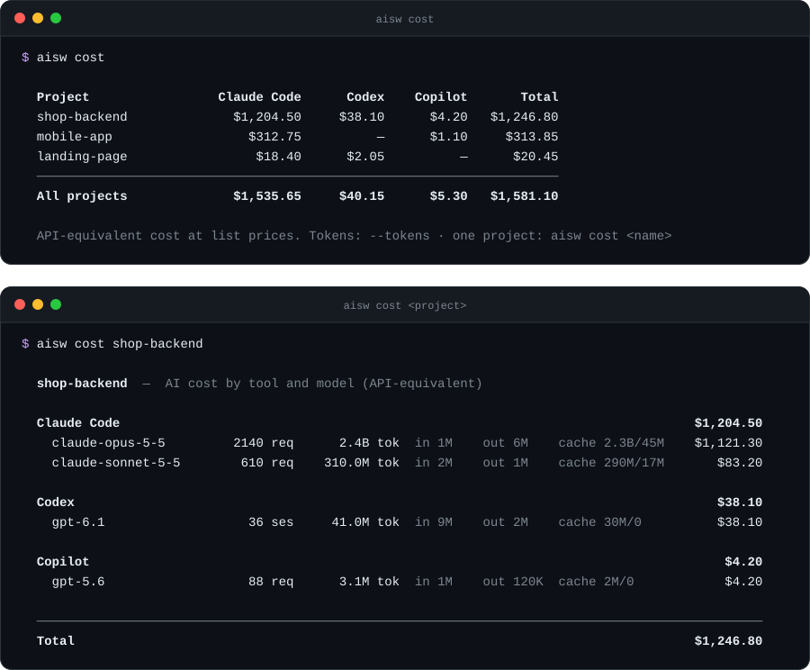

<div align="center">


# AI Account Switcher

`aisw`

**One command to switch accounts in your AI coding CLIs.**

Claude Code · Codex · Cursor · Copilot · OpenCode · Antigravity · Kimi

Use several accounts of the same AI CLI on one machine — a company Claude Team
seat and a personal Max plan, a work and a personal Codex login — and switch
between them in a second, in every terminal at once.

[](https://github.com/yasinkuyu/ai-account-switcher/releases)
[](LICENSE)


</div>

<p align="center">
  
</p>

## Why

- **Zero install hassle** — a single ~2 MB binary. No Node, no Python, no packages.
- **Works everywhere** — macOS, Linux, Windows. Any terminal, any editor.
- **Safe** — saved logins live in your OS credential store (Keychain / Credential Manager), never in plain config.
- **Team + Max on one email** — same email, different organizations? They are two separate accounts.
- **See your limits** — every Claude Code and Codex account shows how much of its 5-hour and weekly limit is used, and when it resets.
- **No restart needed** — open Claude Code sessions move to the new account within ~30 seconds.
- **What each project cost** — tokens and API-equivalent cost per project, per tool and in total, across every AI CLI you used on it.
- **Undo** — every switch keeps the previous login. `aisw undo` brings it back.

## Hit a limit? Switch without closing the session

When Claude Code says the usage limit is reached, don't close it. Right in the
same session (the `!` prefix runs a shell command), or in any other terminal:

```sh
! aisw claude main
```

The open session moves to the `main` account within ~30 seconds — same
conversation, same context. Type `continue` and keep working. No logout, no
restart; `aisw claude work` (or `aisw undo`) takes you back later.

<p align="center">
  
</p>

## Install

> [!WARNING]
> **Tested on macOS only so far.** The Windows and Linux builds compile and run
> the automated tests in CI, but they have not yet been tried with the real
> tools on those systems. If you use them there, please
> [report how it goes](https://github.com/yasinkuyu/ai-account-switcher/issues).


**macOS / Linux**

```sh
curl -fsSL https://raw.githubusercontent.com/yasinkuyu/ai-account-switcher/main/install.sh | sh
```

**Windows** (PowerShell)

```powershell
irm https://raw.githubusercontent.com/yasinkuyu/ai-account-switcher/main/install.ps1 | iex
```

Or download a binary from [Releases](https://github.com/yasinkuyu/ai-account-switcher/releases), or `go install github.com/yasinkuyu/ai-account-switcher/cmd/aisw@latest`.

## Quick start

```sh
aisw
```

That's the whole thing. Pick an account and press **Enter** to switch.
Press **a** to add an account: `aisw` keeps your current one, opens the tool's
own login, and saves the new account when you're done.

Accounts you are logged in to are saved automatically — no setup, no naming.

> [!IMPORTANT]
> Add accounts with **`aisw`** (or `aisw add`), not the tool's own logout.
> Claude Code and Codex revoke your session on the server when you log out,
> so a saved account would stop working. `aisw` only removes the login from
> this machine; the session stays valid and safe.

## Commands

For scripts and power users — everything is also in the menu.

| Command | What it does |
|---|---|
| `aisw` | Interactive menu |
| `aisw add [tool]` | Add another account to a tool |
| `aisw <tool> <name>` | Switch one tool, e.g. `aisw claude max` |
| `aisw <name>` | Switch every tool saved under that name |
| `aisw undo` | Go back to the login you had before the last switch |
| `aisw status [--json]` | Which account each tool is using right now (`--json` for scripts and agents) |
| `aisw list` | List saved accounts |
| `aisw save [name] [tool]` | Save the current logins under a name of your choice |
| `aisw rm <name> [tool]` | Delete a saved account |
| `aisw cost [project]` | AI cost and tokens per project and tool (see below) |
| `aisw prompt` | One-line status for your shell prompt |
| `aisw doctor` | Show where each tool keeps its login on this machine |

Tools: `claude` `codex` `cursor` `copilot` `opencode` `antigravity` `kimi`

## AI cost per project

Several agents on one project? `aisw cost` adds up what each of them used — per project, per tool, and in total:

<p align="center">
  
</p>

| Command | Shows |
|---|---|
| `aisw cost` | every project × every tool, with totals per tool and overall |
| `aisw cost <project>` / `aisw cost .` | one project by tool and model, with input / output / cache tokens |
| `aisw cost --tokens` | the same tables in tokens instead of dollars |
| `aisw cost --since 30d` | only recent usage (`12h`, `4w`, `3m` or a date like `2026-10-01`) |
| `aisw cost --json` | machine-readable, for scripts and agents |

- **Costs are API-equivalent:** what the same tokens cost at list API prices. On a subscription you pay your plan, not this — it shows what the work is worth.
- **Projects are git repositories:** every worktree and sub-folder of a repo counts as one project.
- **History is kept by aisw:** the CLIs delete old logs (Claude Code after 30 days) and worktrees disappear, so every `aisw` command copies new usage records into `~/.aisw/ledger.jsonl.gz` (no prompts, no code, no credentials — only tool, project, model, time and token counts).
- **Prices:** Anthropic models are built in. For other models add dollars per million tokens to `~/.aisw/prices.json`, e.g. `{"gpt-6": {"input": 1.25, "output": 10, "cache_read": 0.125}}`; until then their usage shows as tokens. OpenCode reports its own cost; GitHub Copilot reports AI units.
- **Covered:** Claude Code, Codex, GitHub Copilot CLI and OpenCode (the last two need `sqlite3`, preinstalled on macOS and most Linux). Cursor, Antigravity and Kimi keep no token counts locally.

## How it works

Each CLI keeps its login in a known place. `aisw` copies it into a named profile
and copies it back when you switch:

| Tool | macOS | Linux | Windows |
|---|---|---|---|
| Claude Code | Keychain + `~/.claude.json` | `~/.claude/.credentials.json` + `~/.claude.json` | same as Linux |
| Codex | `~/.codex/auth.json` | `~/.codex/auth.json` | `%USERPROFILE%\.codex\auth.json` |
| Cursor CLI | Keychain | `~/.config/cursor/auth.json` | `%APPDATA%\Cursor\auth.json` |
| GitHub Copilot CLI | `~/.copilot/config.json` ¹ | same | same |
| OpenCode | `~/.local/share/opencode/auth.json` | same | same |
| Antigravity CLI (`agy`) | Keychain | Secret Service (`secret-tool`) | Credential Manager |
| Kimi CLI | `~/.kimi/credentials/kimi-code.json` | same | same |

¹ Copilot already stores one login per GitHub user. `aisw` only changes which
one is active and never touches Copilot's tokens — log in once per account with `copilot login`.

Profiles are stored in the macOS Keychain, Windows Credential Manager, or
`~/.aisw/secrets` (mode `0600`) on Linux. Profile names and labels are in
`~/.aisw/profiles.json` — no tokens there.

### Tested

| | macOS | Linux | Windows |
|---|---|---|---|
| Claude Code (Team ↔ Max on one email) | ✅ | ⚠️ | ⚠️ |
| Codex, GitHub Copilot CLI, OpenCode, Cursor CLI, Antigravity | ☑️ | ⚠️ | ⚠️ |
| Kimi | ⚠️ | ⚠️ | ⚠️ |

✅ switching between two real accounts confirmed ·
☑️ saving and restoring a real login confirmed; switching between two accounts
covered by automated tests, not yet tried with two real accounts ·
⚠️ builds and passes the automated tests in CI, not yet confirmed with the real tool

### How accounts are remembered

```text
 you log in ──► aisw saves the account (OS credential store)
 add account ─► save the current one, remove it from this machine only
                (the session on the server stays valid), run the tool's login,
                save the new one — or restore the old one if you cancel
 switch ─────► 1. re-save the account you are leaving (tokens refresh)
                2. keep it as "_previous" for `aisw undo`
                3. write the chosen account back where the tool reads it
```

A saved account keeps working as long as its session is valid on the server.
If you revoke it elsewhere (or it expires after a long time unused), add it again.

## For AI agents

`aisw` is easy for coding agents to use and to understand:

- [`AGENTS.md`](AGENTS.md) — how agents should use `aisw` safely and how to work on this code
- `aisw status --json` — machine-readable state of every tool (never contains tokens)

## FAQ

**How do I use two Claude Code accounts on one computer?**
Log in to the first one as usual, then run `aisw add claude` and log in to the
second. Switch with `aisw` or `aisw claude <name>`.

**How do I switch accounts in Codex CLI without logging in again?**
Same idea: `aisw add codex` once, then `aisw codex <name>` to switch. Your
`~/.codex/auth.json` is swapped for you.


**Do I have to close my open sessions?**
Not for Claude Code: an open session re-reads its login at most every 30 seconds,
so it continues on the new account without a restart (measured with the usage
API in both directions). Its status line may still show the old account name for
a while; `aisw` marks that with `⚠ login mismatch` and never saves such a mixed
login. For the other tools this is not verified yet — restart open sessions if
they keep using the old account.

**I have a Team seat and a Max plan on the same email. Will they clash?**
No. Claude accounts are identified by user *and* organization, so they show up as two accounts.

**I wipe my AI CLIs and their data every few months. Is my cost history lost?**
No — that is what the ledger is for. It lives in `~/.aisw` (about 2 MB for tens of
thousands of requests, gzip-compressed), apart from the CLIs' own folders. Keep
`~/.aisw` when you clean up, or copy it somewhere safe.

**Should I use `/logout`, `codex logout`, … to change accounts?**
No — press **a** in `aisw` (or run `aisw add`). A tool's logout revokes that
session on the server, so the account you saved would stop working.

**Does it switch the Cursor editor?**
No — only the Cursor CLI (`cursor-agent`). The editor app has its own login.
The Antigravity desktop app *does* share its login with `agy`, so it follows
the switch after a restart.

**Where do the usage limits come from?**
Claude Code: the same endpoint Claude Code's `/usage` screen uses, called with
that account's saved login (skipped if the login has expired — `aisw` never
refreshes a saved login). Codex: the latest limits Codex itself wrote into its
session logs for that account, so no network request. Other tools don't expose
their limits locally yet.

**An API key environment variable is set.**
`ANTHROPIC_API_KEY`, `OPENAI_API_KEY`, `CURSOR_API_KEY` or `GH_TOKEN` / `GITHUB_TOKEN` override logins in those tools.
`aisw doctor` warns you about them.

**Is this against the tools' terms?**
`aisw` only moves your own login files between your own accounts on your own machine.
It does not share, proxy or pool accounts. Use each account according to its plan's terms.

## Build from source

```sh
git clone https://github.com/yasinkuyu/ai-account-switcher && cd ai-account-switcher
go build -o aisw ./cmd/aisw       # current platform
go test ./...                     # tests (never touch your real logins)
./scripts/build.sh          # all platforms → dist/
```

## License

[MIT](LICENSE)
